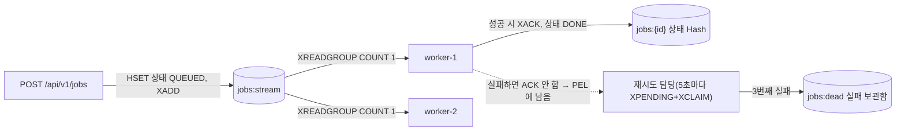

# 단계 19 실습 워크북 — 작업 큐(Redis Streams)를 직접 만들기

> 선수 지식: Redis 기본 명령([[REDIS-BASICS]]), `StringRedisTemplate`([[REDIS-TOKEN]]), `@Scheduled`·`@TransactionalEventListener`([[LIVE-POLL]]).
> 이 문서는 **직접 코드를 쓰는 실습서**다. 각 Step의 "직접 작성"을 먼저 해 보고, 막히면 [[JOB-QUEUE-ANSWERS]]의 같은 Step을 본다.
> 모든 "기대 출력·로그"는 정답 코드(`answer/job-queue` 브랜치)를 실제로 실행해 얻은 것이다.

요청을 받은 스레드가 오래 걸리는 일을 직접 하지 않고 **"할 일 쪽지"(job)를 큐에 넣고 바로 응답**하면, 별도의 **작업자(worker)** 가 나중에 꺼내 처리한다.
이 실습에서는 board 앱 안에 Redis Streams로 그런 작업 큐를 만들고, 작업자가 실패하거나 죽어도 job이 사라지지 않게 하는 장치까지 직접 구현한다.

학습 목표 — 실습을 마치면 다음을 할 수 있다.

- 요청은 `202 Accepted`로 즉시 응답하고, 실제 작업은 작업자가 나중에 처리하는 구조를 만든다
- Redis Streams의 `XADD`(넣기)·`XREADGROUP`(작업자 그룹으로 나눠 받기)·`XACK`(완료 표시)를 코드로 쓴다
- 처리 중 목록(**PEL**)과 `XPENDING`·`XCLAIM`(넘겨받기)으로 **실패 재시도와 작업자 다운 복구**를 구현한다
- 3번 실패한 job을 실패 보관함(**DLQ**)으로 옮기고, 상태·통계를 Postman·로그·`redis-cli`로 확인한다

---

## 1. 한눈에 보기

### 1-1. 만들 것

| API | 하는 일 |
|-----|---------|
| `POST /api/v1/jobs` | `{ "durationSeconds": 3, "failTimes": 0 }` → **202** + `jobId`. `durationSeconds`(1~10)만큼 일하는 척하고, 처음 `failTimes`(0~5)번은 일부러 실패하는 데모 job |
| `GET /api/v1/jobs/{jobId}` | 상태 조회 — `QUEUED → RUNNING → DONE`, 실패 시 `RETRY_WAIT → … → FAILED` |
| `GET /api/v1/jobs/stats` | 큐 길이, 처리 중(PEL) 개수, 작업자별 현황, 실패 보관함 개수 |



### 1-2. 작업 순서와 이유

| Step | 만드는 것 | 이 순서인 이유 | 확인 방법 |
|------|-----------|----------------|-----------|
| 0 | (코드 없음) `redis-cli`로 Streams 체험 | 코드보다 명령을 먼저 손에 익힌다 | `redis-cli` 출력 |
| 1 | 설정 `app.jobs.*`, `JobProperties`, `JOB_NOT_FOUND` | 모든 클래스가 설정을 쓴다 | 바인딩 테스트 |
| 2 | `JobStatus`, `JobView`, `JobStore` | 생산자·작업자가 상태를 읽고 쓴다 | Redis 테스트 |
| 3 | `JobSubmitRequest`, `JobProducer`, `JobController` | 넣는 쪽부터 — 작업자 없이 "쌓이는" 것을 먼저 본다 | Postman: 영원히 `QUEUED`, `XLEN` 증가 |
| 4 | `JobWorker`, `JobQueueConfig` | 꺼내는 쪽 | Postman: `DONE`, 로그로 분배 |
| 5 | `JobReclaimer` (+ 재시도 스레드) | 실패한 job 되살리기 | Postman: 재시도 후 `DONE` / 3회 후 `FAILED` |
| 6 | (코드 없음) 작업자 다운 실험 | Step 5가 다운 복구까지 해 주는지 | `kill -9` → 재시작 → `DONE` |
| 7 | `JobStats`, `JobMonitor`, `/stats` | 큐를 관측하는 창 | Postman `/stats` |
| 8 | 테스트 3개 | 손으로 확인한 것을 자동화 | `./gradlew test` |

---

## 2. 개념 — 코드 전에 꼭 알아야 할 다섯 가지

### 2-1. 왜 큐인가

| 방식 | 사용자가 겪는 것 |
|------|------------------|
| 요청 안에서 바로 처리 | 10초짜리 일이면 10초 동안 응답이 없다. 서버가 그사이 죽으면 일도 결과도 사라진다 |
| 큐에 넣고 202 | 즉시 응답. 일은 작업자가 처리하고, 상태는 조회 API로 본다. 작업자가 죽어도 job은 Redis에 남는다 |

### 2-2. Redis Streams 한 장 요약

| 개념 | 뜻 | 명령 |
|------|----|------|
| Stream | 추가만 되는 로그. 레코드마다 시간 기반 id(`1792172101526-0`) | `XADD`, `XLEN`, `XRANGE` |
| Consumer group | 여러 작업자가 한 스트림을 **나눠** 받는 단위. 같은 레코드는 그룹 안에서 한 명에게만 간다 | `XGROUP CREATE` |
| Consumer | 그룹 안의 작업자 이름(`worker-1`) | `XREADGROUP GROUP g name` |
| `>` | "아직 아무도 받지 않은 새 레코드" | `XREADGROUP … STREAMS s >` |
| **PEL** | 받았지만 아직 ACK하지 않은 레코드 목록(누가, 몇 ms 동안, 몇 번 전달됐나) | `XPENDING` |
| ACK | "다 했다" — PEL에서 뺀다. **레코드를 지우지는 않는다** | `XACK` |
| 넘겨받기 | 오래 방치된 PEL 항목의 주인을 바꾼다. 전달 횟수가 1 늘어난다 | `XCLAIM`, `XAUTOCLAIM`(6.2+) |

### 2-3. 실패와 다운을 같은 방법으로 다룬다

작업자는 **성공했을 때만 ACK**한다. 실패해도, 처리 중에 죽어도 레코드는 PEL에 남는다. 재시도 담당이 5초마다 PEL을 훑어
"15초 넘게 방치된" 항목을 넘겨받아 다시 실행한다. 전달 횟수가 3이 되면 더 시도하지 않고 실패 보관함으로 옮긴다.

> [!IMPORTANT]
> **방치 기준 시간(min-idle 15초)은 반드시 최대 작업 시간(10초)보다 길어야 한다.** 짧으면 아직 일하고 있는 job을 "방치됐다"고 보고 넘겨받아 같은 일을 두 번 한다(중복 실행). 그리고 넘겨받은 job은 **곧바로 실행이 시작돼야** 이 규칙이 성립한다 — 그래서 재시도 담당은 빈 실행 스레드가 있을 때만 넘겨받는다(Step 5).

### 2-4. 한 번에 하나씩 가져가기(prefetch 함정)

`XREADGROUP`에 `COUNT`를 주지 않으면, 쌓여 있던 job을 **한 작업자가 몽땅** 가져가 자기 PEL에 넣는다. 다른 작업자는 논다.
정답 코드를 처음 실행했을 때 실제로 이 현상이 나왔다 — job 4개 중 3·4번을 worker-1이 둘 다 가져가 9초가 걸렸고, `COUNT 1`로 고친 뒤 2개씩 나눠 6초가 걸렸다.

### 2-5. 오류 한 번에 작업자가 조용히 죽지 않게

Spring의 리스너 컨테이너는 기본값으로 **읽기 오류가 한 번 나면 그 작업자의 구독을 영구 취소**한다(`cancelOnError = true`).
실습 중 `DEL jobs:stream`을 하면 그 순간부터 job이 영원히 `QUEUED`로 남는다. 그래서 `cancelOnError(e -> false)`로 등록하고, 오류가 이어질 때 로그가 폭주하지 않게 1초씩 쉬게 한다.

---

## 3. 준비

| 준비물 | 명령 / 확인 |
|--------|-------------|
| 실습 브랜치 | `git checkout main && git pull && git checkout -b practice/job-queue` |
| MySQL | 기존 로컬 `mysql-8`(127.0.0.1:3306) |
| **Redis(호스트 6379)** | `docker run -d --name jobs-redis -p 127.0.0.1:6379:6379 redis:7-alpine` — compose의 `board-redis`는 호스트에 열려 있지 않다 |
| 앱 실행 | `./gradlew bootRun` (8090). 로그는 이 터미널에 찍힌다 |
| 로그만 골라 보기 | `./gradlew bootRun 2>&1 \| grep -E "\[(jobs\|producer\|worker-\|reclaimer)"` |
| Postman | 단계 18 실습의 `live-local` 환경 재사용 — `baseUrl`=`http://localhost:8090`, 로그인 후 `hostToken` 저장([[LIVE-POLL-POSTMAN]] §3) |

> 주의: Step 4부터 앱은 **기동할 때 Redis에 그룹을 만든다.** Redis가 꺼져 있으면 앱이 뜨지 않는다(로그인 토큰 폐기 목록도 원래 Redis가 필요하다).

---

## 4. Step 0 — 코드 전에 `redis-cli`로 손에 익히기

**목표**: 앱이 할 일을 손으로 먼저 해 본다. 앱과 겹치지 않게 **`demo:stream`** 키를 쓴다(`jobs:stream`에 넣으면 앱의 작업자가 그 레코드를 가져가 "형식 오류"로 버린다).

```bash
docker exec -it jobs-redis redis-cli
```

| 순서 | 명령 | 실제 출력(요약) | 뜻 |
|------|------|-----------------|----|
| 1 | `XADD demo:stream * task hello` | `1792173094352-0` | 레코드 추가, `*` = id 자동 |
| 2 | `XADD demo:stream * task world` | `1792173094432-0` | |
| 3 | `XLEN demo:stream` | `2` | |
| 4 | `XGROUP CREATE demo:stream demo-group 0 MKSTREAM` | `OK` | `0` = 처음부터 읽는 그룹 |
| 5 | `XREADGROUP GROUP demo-group alice COUNT 1 STREAMS demo:stream >` | `… task hello` | alice가 1개 |
| 6 | `XREADGROUP GROUP demo-group bob COUNT 1 STREAMS demo:stream >` | `… task world` | bob은 **다른** 1개 — 나눠 받기 |
| 7 | `XPENDING demo:stream demo-group` | `2 … alice 1 bob 1` | 둘 다 아직 ACK 전 |
| 8 | `XACK demo:stream demo-group <hello의 id>` | `1` | alice 완료 |
| 9 | `XPENDING demo:stream demo-group - + 10` | `<world id> bob 284 1` | 남은 1개: 주인 bob, 284ms 방치, 전달 1회 |
| 10 | (2초 뒤) `XCLAIM demo:stream demo-group carol 1000 <world id>` | `… task world` | 1초 넘게 방치 → carol이 넘겨받음 |
| 11 | `XPENDING demo:stream demo-group - + 10` | `<world id> carol 70 2` | 주인 carol, **전달 2회** |
| 12 | (2초 뒤) `XAUTOCLAIM demo:stream demo-group dave 1000 0 COUNT 10` | `0-0 … task world` | 조회+넘겨받기를 한 번에(Redis 6.2+) |
| 13 | `XPENDING demo:stream demo-group - + 10` | `<world id> dave 72 3` | 전달 3회 |
| 14 | `XLEN demo:stream` | `2` | **ACK해도 레코드는 그대로** — ACK는 삭제가 아니다 |
| 15 | `DEL demo:stream` | `1` | 정리 |

> 팁: 우리 코드는 12번 `XAUTOCLAIM` 대신 9·10번(`XPENDING` + `XCLAIM`)을 쓴다. Spring Data Redis 3.5에는 `XAUTOCLAIM` API가 없기 때문이다. 대신 전달 횟수가 코드에 그대로 드러나서 "3번이면 포기" 같은 판단이 읽기 쉽다.

---

## 5. Step 1 — 설정과 오류 코드

**목표**: 큐 이름, 작업자 수, 재시도 기준을 설정 파일 한 곳에 모은다. **테스트에서는 작업자를 띄우지 않는다**(기존 테스트 수백 개가 Redis 없이 돌아야 하므로).

| 파일 | 할 일 |
|------|-------|
| `src/main/resources/application.yaml` | `app:` 아래에 `jobs:` 블록 추가 |
| `src/test/resources/application.yaml` | 같은 블록, 단 `enabled: false` |
| `global/exception/ErrorCode.java` | `JOB_NOT_FOUND`(404) 추가 |
| `jobs/JobProperties.java` (신규) | `@ConfigurationProperties(prefix = "app.jobs")` record |

**직접 작성**

```yaml
  jobs:
    enabled: ${APP_JOBS_ENABLED:true}
    stream: jobs:stream
    group: job-workers
    dead-stream: jobs:dead
    workers: 2
    max-attempts: 3
    min-idle-ms: 15000          # 최대 작업 시간(10초)보다 길게!
    reclaim-interval-ms: 5000
    status-ttl-hours: 24
    work-unit-ms: 1000          # "일하는 척" 1단위 = 1초 (테스트는 줄여 쓴다)
```

```java
@ConfigurationProperties(prefix = "app.jobs")
public record JobProperties(
    // TODO(직접 작성): 위 yaml 키 10개를 같은 순서로 — enabled, stream, group, deadStream, workers,
    //                  maxAttempts, minIdleMs, reclaimIntervalMs, statusTtlHours, workUnitMs
) {
}
```

**힌트**: `dead-stream` → `deadStream`처럼 케밥 표기는 카멜로 자동 바인딩된다. `BoardApplication`에 `@ConfigurationPropertiesScan`이 이미 있어 별도 등록이 필요 없다.

**확인**: [[JOB-QUEUE-ANSWERS]] Step 8의 `JobPropertiesBindingTest`를 붙여 넣고 `./gradlew test --tests '*JobPropertiesBindingTest'` → PASS

---

## 6. Step 2 — 상태 저장소

**목표**: job 상태를 Redis Hash `jobs:{jobId}`에 둔다. TTL 1일로 자동 정리.

| 파일 | 역할 |
|------|------|
| `jobs/JobStatus.java` | `QUEUED, RUNNING, RETRY_WAIT, DONE, FAILED` |
| `jobs/JobView.java` | 응답 record: `jobId, status, attempts, worker, result, error, createdAt, updatedAt` + `static from(String jobId, Map<Object,Object> hash)` |
| `jobs/JobStore.java` | `create`, `update`, `incrementAttempts`, `find`, `static key` |

**직접 작성 — `JobStore` 뼈대**

```java
@Component
@RequiredArgsConstructor
public class JobStore {

  private final StringRedisTemplate redis;
  private final JobProperties props;

  static String key(String jobId) {
    return "jobs:" + jobId;
  }

  public void create(String jobId) {
    // TODO: status=QUEUED, attempts=0, createdAt/updatedAt=Instant.now() 를 write
  }

  public void update(String jobId, JobStatus status, Map<String, String> extra) {
    // TODO: extra + status + updatedAt 를 write
  }

  public long incrementAttempts(String jobId) {
    // TODO: HINCRBY — redis.opsForHash().increment(key, "attempts", 1)
  }

  public Optional<JobView> find(String jobId) {
    // TODO: HGETALL(entries) — 비어 있으면 Optional.empty()
  }

  private void write(String jobId, Map<String, String> fields) {
    // TODO: HSET(putAll) 후 EXPIRE(statusTtlHours)
  }
}
```

**힌트**: `StringRedisTemplate`의 Hash는 값을 모두 **문자열**로 저장한다 — 숫자도 `"0"`.

**확인**(앱 기동 전이라 `redis-cli`로): Step 3 이후 Postman으로 확인한다. 테스트는 Step 8.

---

## 7. Step 3 — 생산자와 API: 작업자 없이 "쌓이는" 것부터 본다

**목표**: `POST /api/v1/jobs`가 상태를 만들고 스트림에 넣은 뒤 **202**로 즉시 응답한다. 아직 작업자가 없으므로 job은 영원히 `QUEUED`다 — 이것이 정상이다.

| 파일 | 역할 |
|------|------|
| `jobs/JobSubmitRequest.java` | `@NotNull @Min(1) @Max(10) Integer durationSeconds`, `@NotNull @Min(0) @Max(5) Integer failTimes` |
| `jobs/JobProducer.java` | `submit(request)`: jobId(UUID) → `store.create` → `XADD` → 로그 → `store.find` |
| `jobs/JobController.java` | `POST`(202), `GET /{jobId}`(없으면 `JOB_NOT_FOUND`) |

**직접 작성 — 생산자의 핵심 두 줄**

```java
    store.create(jobId);                         // ① 상태부터 — 작업자가 언제 꺼내도 상태를 찾을 수 있게
    RecordId recordId = redis.opsForStream().add(props.stream(), Map.of(   // ② XADD jobs:stream * …
        "jobId", jobId,
        "durationSeconds", String.valueOf(request.durationSeconds()),
        "failTimes", String.valueOf(request.failTimes())));
```

로그 형식(뒤 Step에서 흐름을 읽는 기준이 되므로 그대로):

```java
    log.info("[producer] job={} queued record={} duration={}s failTimes={}", …);
```

**힌트**: 상태 코드 202는 `@ResponseStatus(HttpStatus.ACCEPTED)`. `durationSeconds` 상한 10은 §2-3 규칙 때문이다.

**확인 — Postman**

| 요청 | 설정 | 기대 |
|------|------|------|
| Submit job | `POST {{baseUrl}}/api/v1/jobs`, Bearer `{{hostToken}}`, Body `{ "durationSeconds": 3, "failTimes": 0 }` | **202**, `"status": "QUEUED"` |
| Get job | `GET {{baseUrl}}/api/v1/jobs/{{jobId}}` | 몇 번을 보내도 `QUEUED` (작업자가 없다) |
| 검증 | Body `durationSeconds: 11` | 400 `INVALID_INPUT` |

Submit job의 Post-response 스크립트:

```js
pm.environment.set("jobId", pm.response.json().jobId);
```

**확인 — `redis-cli`**

```bash
docker exec jobs-redis redis-cli XLEN jobs:stream            # 보낸 횟수만큼 늘어남
docker exec jobs-redis redis-cli XRANGE jobs:stream - + COUNT 1
docker exec jobs-redis redis-cli HGETALL jobs:<jobId>         # status QUEUED
```

---

## 8. Step 4 — 작업자와 리스너 컨테이너

**목표**: 앱이 뜰 때 그룹을 만들고, 작업자 2명이 같은 그룹으로 job을 나눠 받아 처리한다. **성공했을 때만 ACK**한다.

| 파일 | 역할 |
|------|------|
| `jobs/JobWorker.java` | `process(workerName, recordId, fields)`: 필드 검증 → `attempts+1`·`RUNNING` → 일하는 척 → 처음 `failTimes`번은 실패(ACK 안 함, `RETRY_WAIT`) → 성공 시 `DONE` + `XACK` |
| `jobs/JobQueueConfig.java` | `@ConditionalOnProperty(app.jobs.enabled)`: 그룹 생성(이미 있으면 통과) + 리스너 컨테이너 + 작업자 N명 구독 |

**직접 작성 — `JobWorker.process`의 흐름**

```java
  public boolean process(String workerName, String recordId, Map<String, String> fields) {
    // 1) jobId·durationSeconds·failTimes 꺼내기. 하나라도 없거나 숫자가 아니면
    //    → jobs:dead에 기록 + XACK + warn 로그 후 return false   ("독약" 레코드 — §9 문제 해결)
    // 2) long attempt = store.incrementAttempts(jobId); store.update(jobId, RUNNING, worker=workerName)
    //    log.info("[{}] start job={} attempt={} record={}", …)
    // 3) try { 일하는 척(work) → attempt <= failTimes 면 IllegalStateException("의도된 실패 a/f")
    //          → 성공: update(DONE, result) → XACK → log "[{}] done job={} → XACK" → return true }
    //    catch (InterruptedException)  → 인터럽트 복구, ACK 안 함, return false
    //    catch (RuntimeException)      → update(RETRY_WAIT, error), ACK 안 함, warn 로그, return false
  }
```

**직접 작성 — 구독 등록 (Step 4에서 가장 중요한 10줄)**

```java
    StreamMessageListenerContainerOptions<String, MapRecord<String, String, String>> options =
        StreamMessageListenerContainerOptions.builder()
            .pollTimeout(Duration.ofSeconds(2))   // XREADGROUP BLOCK 2000
            .batchSize(1)                         // XREADGROUP COUNT 1 — §2-4 prefetch 함정
            .errorHandler(JobQueueConfig::backoffOnError)   // 오류 시 warn + 1초 대기
            .build();
    // …
    for (int i = 1; i <= props.workers(); i++) {
      String name = "worker-" + i;
      StreamReadRequest<String> request = StreamReadRequest
          .builder(StreamOffset.create(props.stream(), ReadOffset.lastConsumed()))   // ">"
          .consumer(Consumer.from(props.group(), name))
          .autoAcknowledge(false)                 // ACK는 작업자가 성공했을 때 직접
          .cancelOnError(e -> false)              // §2-5 — 기본값 true면 오류 한 번에 구독 영구 취소
          .build();
      container.register(request, record -> worker.process(name, record.getId().getValue(), record.getValue()));
    }
```

그룹 만들기는 재기동마다 "이미 있음"(BUSYGROUP) 오류가 나는 것이 정상이다:

```java
  static void createGroupIfAbsent(StringRedisTemplate redis, JobProperties props) {
    try {
      redis.opsForStream().createGroup(props.stream(), ReadOffset.from("0"), props.group());   // MKSTREAM 포함
      log.info("[jobs] 그룹 생성: {}", props.group());
    } catch (DataAccessException e) {
      // TODO: 가장 안쪽 원인 메시지에 "BUSYGROUP"이 있으면 info 로그 후 통과, 아니면 다시 throw
      //       힌트: NestedExceptionUtils.getMostSpecificCause(e).getMessage()
    }
  }
```

> 주의: 이 Step에서는 `JobQueueConfig`에 **`jobRetryExecutor` 빈을 아직 넣지 않는다**. 그 빈은 Step 5의 `JobReclaimer.RETRY_THREADS`를 쓰므로 Step 5에서 추가한다.

**확인 — 앱 재기동 후 로그**

```text
[jobs] 그룹 생성: job-workers
[jobs] 리스너 시작: stream=jobs:stream group=job-workers workers=2
```

Step 3에서 쌓아 둔 job은 그룹을 `0`(처음부터)으로 만들었기 때문에 **기동하자마자 처리된다** — `GET {{baseUrl}}/api/v1/jobs/{{jobId}}`가 `DONE`.

**확인 — 시나리오 ① 정상 처리** (Submit job → 1초 간격으로 Get job)

| 시각 | Get job 응답 |
|------|--------------|
| 직후 | `RUNNING`, attempts 1, worker `worker-1` |
| 3초 뒤 | `DONE`, result `worker-1가 3초 작업 완료` |

```text
02:49:02.497 JobProducer: [producer] job=946bb779… queued record=1792172942491-0 duration=3s failTimes=0
02:49:02.509 JobWorker: [worker-1] start job=946bb779… attempt=1 record=1792172942491-0
02:49:05.541 JobWorker: [worker-1] done job=946bb779… → XACK
```

**확인 — 시나리오 ② 분배** (Submit job을 4번 연달아)

```text
02:49:06.602 JobWorker: [worker-2] start job=88e89774… attempt=1
02:49:06.640 JobWorker: [worker-1] start job=c9478794… attempt=1
02:49:09.631 JobWorker: [worker-2] done job=88e89774… → XACK
02:49:09.645 JobWorker: [worker-2] start job=f480536c… attempt=1
02:49:09.646 JobWorker: [worker-1] done job=c9478794… → XACK
02:49:09.654 JobWorker: [worker-1] start job=73d5f032… attempt=1
02:49:12.690 JobWorker: [worker-2] done job=f480536c… → XACK
02:49:12.690 JobWorker: [worker-1] done job=73d5f032… → XACK
```

두 작업자가 2개씩, 총 6초. `batchSize(1)`을 빼고 다시 해 보면 한 작업자가 3·4번을 둘 다 가져가 9초가 걸리는 것을 직접 볼 수 있다.

**확인 — 실패는 아직 "멈춘다"**: Body `failTimes: 1`로 보내면 `RETRY_WAIT`에서 영원히 멈춘다. 되살리는 것은 Step 5의 몫이다.

```bash
docker exec jobs-redis redis-cli XPENDING jobs:stream job-workers - + 10   # 그 job이 PEL에 남아 있다
```

---

## 9. Step 5 — 재시도 담당과 실패 보관함

**목표**: 5초마다 PEL을 훑어 15초 넘게 방치된 job을 넘겨받아 다시 실행한다. 전달 3회면 실패 보관함으로 옮기고 `FAILED`.

| 파일 | 할 일 |
|------|-------|
| `jobs/JobReclaimer.java` (신규) | `@Component @ConditionalOnProperty(app.jobs.enabled)`, `@Scheduled(fixedDelayString = "${app.jobs.reclaim-interval-ms}")` |
| `jobs/JobQueueConfig.java` | `jobRetryExecutor` 빈 추가(스레드 `RETRY_THREADS`개) |

**직접 작성 — `reclaim()`의 흐름**

```java
  static final String RECLAIMER = "reclaimer";
  static final int RETRY_THREADS = 2;
  private final Semaphore freeThreads = new Semaphore(RETRY_THREADS);   // 빈 실행 스레드 수

  @Scheduled(fixedDelayString = "${app.jobs.reclaim-interval-ms}",
      initialDelayString = "${app.jobs.reclaim-interval-ms}")
  public void reclaim() {
    // XPENDING jobs:stream job-workers - + 50
    PendingMessages pending = redis.opsForStream().pending(props.stream(), props.group(), Range.unbounded(), 50);
    for (PendingMessage entry : pending) {
      // 1) entry.getElapsedTimeSinceLastDelivery() < minIdle → continue (아직 처리 중일 수 있다)
      // 2) try { reclaimOne(entry) } catch (RuntimeException e) { warn } — 한 항목이 나머지를 막지 않게
    }
  }

  private void reclaimOne(PendingMessage entry) {
    // a) entry.getTotalDeliveryCount() >= maxAttempts → deadLetter(entry); return
    // b) freeThreads.tryAcquire() 실패 → return (다음 회차에) — §2-3 "넘겨받으면 곧바로 실행"
    // c) XCLAIM: redis.opsForStream().claim(stream, group, RECLAIMER, Duration.ofMillis(minIdle), entry.getId())
    //    비어 있으면(그새 다른 쪽이 가져감) release 후 return
    // d) log "[reclaimer] claimed job={} from={} deliveries={}"
    //    executor.execute(() -> { try { worker.process(RECLAIMER, …) } catch (…) { warn } finally { freeThreads.release(); } })
  }

  private void deadLetter(PendingMessage entry) {
    // XRANGE로 원래 레코드를 읽어 jobs:dead에 XADD(jobId, originalId, deliveries, error)
    // jobId가 있으면 상태 FAILED / 마지막에 XACK(더는 재시도하지 않음)
  }
```

**힌트**

- `XCLAIM`에 min-idle을 함께 넘기면 "그동안 정말 방치됐을 때만" 원자적으로 넘겨받는다 — 다른 인스턴스와 경쟁해도 한 명만 성공한다.
- 재실행을 `@Scheduled` 스레드에서 직접 하지 않는 이유: 그 스레드는 단계 18의 SSE heartbeat와 **공유**한다. 10초짜리 job이 heartbeat를 막으면 라이브 화면이 "재연결 중"이 된다.
- 테스트에서는 executor 자리에 `Runnable::run`(즉시 실행)을 넣는다.

**확인 — 시나리오 ③ 재시도와 실패 보관함** (Body `failTimes: 1` 하나, `failTimes: 5` 하나를 연달아)

| 시각 | `failTimes: 1` | `failTimes: 5` |
|------|----------------|----------------|
| 0초 | `RUNNING` 1 worker-2 | `RUNNING` 1 worker-1 |
| 2초 | `RETRY_WAIT` 1 | `RETRY_WAIT` 1 |
| 약 18초 | `RUNNING` 2 reclaimer | `RUNNING` 2 reclaimer |
| 약 20초 | **`DONE`** 2 reclaimer | `RETRY_WAIT` 2 |
| 약 33~35초 | | `RUNNING` 3 → `RETRY_WAIT` 3 |
| 약 48초 | | **`FAILED`** 3 |

```text
02:49:15.830 JobWorker: [worker-2] fail job=599edc8b… attempt=1 cause=의도된 실패 1/1 — ACK 안 함(재시도 대기)
02:49:31.436 JobReclaimer: [reclaimer] claimed job=599edc8b… from=worker-2 deliveries=2
02:49:33.451 JobWorker: [reclaimer] done job=599edc8b… → XACK
02:49:46.484 JobReclaimer: [reclaimer] claimed job=bb592c61… from=reclaimer deliveries=3
02:49:48.504 JobWorker: [reclaimer] fail job=bb592c61… attempt=3 cause=의도된 실패 3/5 — ACK 안 함(재시도 대기)
02:50:01.536 JobReclaimer: [reclaimer] dead-letter job=bb592c61… deliveries=3 → jobs:dead
```

```bash
docker exec jobs-redis redis-cli XRANGE jobs:dead - +    # jobId, originalId, deliveries 3, error "의도된 실패 3/5"
```

---

## 10. Step 6 — 작업자가 죽으면? (코드 없음)

**목표**: Step 5의 재시도 담당이 **처리 도중 죽은 작업자의 job까지** 되살리는지 실험한다.

| 순서 | 할 일 | 기대 |
|------|-------|------|
| 1 | Body `{ "durationSeconds": 10, "failTimes": 0 }` 제출 | |
| 2 | 3초 뒤 Get job | `RUNNING` 1 worker-1 |
| 3 | 앱 강제 종료: `kill -9 $(lsof -t -iTCP:8090 -sTCP:LISTEN)` (Ctrl+C가 아니라 진짜 "죽음") | |
| 4 | `docker exec jobs-redis redis-cli XPENDING jobs:stream job-workers - + 10` | `<id> worker-1 4509 1` — 주인이 죽었는데 PEL에 남아 있다 |
| 5 | `./gradlew bootRun`으로 재시작 | `[jobs] 그룹 이미 있음: job-workers` |
| 6 | 15~20초 기다리며 Get job | `RUNNING` 2 reclaimer → **`DONE`** 2 reclaimer |

```text
02:50:21.984 JobQueueConfig: [jobs] 그룹 이미 있음: job-workers
02:50:27.221 JobReclaimer: [reclaimer] claimed job=c0816ef3… from=worker-1 deliveries=2
02:50:27.234 JobWorker: [reclaimer] start job=c0816ef3… attempt=2 record=1792173001671-0
02:50:37.297 JobWorker: [reclaimer] done job=c0816ef3… → XACK
```

> 중요: 재시작한 앱도 이름이 `worker-1`이지만, `>`(새 레코드)만 읽기 때문에 이전 PEL 항목을 스스로 가져가지 않는다. 그것을 되살리는 것이 재시도 담당이다. 이것이 **at-least-once**(최소 한 번 실행) — 대신 같은 job이 두 번 실행될 수 있으므로 실무 작업은 두 번 실행돼도 결과가 같게(멱등) 만든다.

---

## 11. Step 7 — 통계 API

**목표**: `redis-cli`의 `XLEN`·`XPENDING`·`XINFO CONSUMERS`를 API 하나로 본다.

| 파일 | 할 일 |
|------|-------|
| `jobs/JobStats.java` | `record JobStats(long streamLength, long pending, List<ConsumerStat> consumers, long deadLetters)` + 안쪽 `record ConsumerStat(String name, long pending, long idleMs)` |
| `jobs/JobMonitor.java` | `size(stream)`, `pending(stream, group).getTotalPendingMessages()`, `consumers(stream, group)` → `consumerName()/pendingCount()/idleTimeMs()`, `size(deadStream)`. 그룹이 없으면(NOGROUP) 0으로 |
| `jobs/JobController.java` | `GET /stats` 추가 |

**확인 — Postman** `GET {{baseUrl}}/api/v1/jobs/stats`

```json
{"streamLength":7,"pending":0,"consumers":[{"name":"reclaimer","pending":0,"idleMs":15155},{"name":"worker-1","pending":0,"idleMs":104},{"name":"worker-2","pending":0,"idleMs":104}],"deadLetters":1}
```

> 주의: `streamLength`는 "대기 중인 job 수"가 아니라 **지금까지 넣은 누적 개수**다(ACK는 삭제가 아니다, Step 0의 14번). 대기 중인 양은 `pending`과 작업자별 `pending`으로 본다. 운영에서는 `XADD … MAXLEN ~ 10000`이나 주기적 `XTRIM`으로 길이를 제한한다.

---

## 12. Step 8 — 테스트

**목표**: 손으로 확인한 것을 자동화한다. 세 파일을 [[JOB-QUEUE-ANSWERS]] Step 8에서 가져온다.

| 테스트 | 무엇을 | Redis 필요 |
|--------|--------|-----------|
| `JobPropertiesBindingTest` | 설정 바인딩, 테스트에선 `enabled=false` | 아니오 |
| `JobControllerTest` | 202·400·404·401·stats — 생산자/저장소는 `@MockitoBean`으로 대체 | 아니오 |
| `JobFlowRedisTest` | 실제 Redis(DB 14)로 큐 흐름 전체 18케이스 — 없으면 건너뜀 | 예 |

```bash
./gradlew test                                              # Redis 없이: JobFlowRedisTest는 skip
./gradlew test --rerun --tests 'com.example.board.jobs.*'   # jobs-redis(6379) 기동 상태: 전부 실행
```

`JobFlowRedisTest`의 핵심 케이스:

| 케이스 | 검증 |
|--------|------|
| `should_markDone_andAck_onSuccess` | 성공 → DONE, PEL 0 |
| `should_leaveInPending_onFailure` | 실패 → RETRY_WAIT, PEL 1 |
| `should_retryFailedJob_untilDone` | 넘겨받아 재실행 → DONE, attempts 2 |
| `should_moveToDeadLetter_afterMaxAttempts` | 3회 후 FAILED + `jobs:dead` 1 |
| `should_reclaimAbandonedJob` | 받아 놓고 죽은 job → DONE |
| `should_distributeQueuedJobs_acrossWorkers` | 실제 리스너로 worker-1·2 분배(prefetch 함정) |
| `should_claimOnlyAsManyAsFreeRetryThreads` | 빈 스레드 수만큼만 넘겨받음(중복 실행 방지) |
| `should_keepWorking_afterReadErrors` | 스트림 삭제(NOGROUP) 후에도 작업자 생존 |
| `should_sendMalformedRecord_toDeadLetter_withoutThrowing` | 필드 없는 레코드 → 보관함 + ACK |

---

## 13. 최종 테스트 — Postman과 로그로 시나리오 4가지

### 13-1. Postman 컬렉션 구성

| 요청 | 메서드 / URL | Authorization | Body | Post-response |
|------|--------------|---------------|------|---------------|
| Login | `POST {{baseUrl}}/api/v1/auth/login` | No Auth | `{ "username": "…", "password": "…" }` | `pm.environment.set("hostToken", pm.response.json().accessToken);` |
| Submit job | `POST {{baseUrl}}/api/v1/jobs` | Bearer `{{hostToken}}` | `{ "durationSeconds": 3, "failTimes": 0 }` | `pm.environment.set("jobId", pm.response.json().jobId);` |
| Get job | `GET {{baseUrl}}/api/v1/jobs/{{jobId}}` | Bearer `{{hostToken}}` | 없음 | — |
| Stats | `GET {{baseUrl}}/api/v1/jobs/stats` | Bearer `{{hostToken}}` | 없음 | — |

> 팁: Get job을 1초 간격으로 반복하려면 Collection Runner에서 Get job만 골라 Iterations 20, Delay 1000ms로 실행한다.

### 13-2. 시나리오 체크리스트

| # | 시나리오 | 보내는 것 | 통과 기준(응답) | 통과 기준(로그) |
|---|----------|-----------|----------------|-----------------|
| ① | 정상 | `3, 0` | 202 → `RUNNING` → 3초 뒤 `DONE` | `start` → `done … → XACK` |
| ② | 분배 | `3, 0` × 4 연달아 | 모두 `DONE` | worker-1·worker-2가 2개씩, 약 6초 |
| ③ | 재시도 / DLQ | `2, 1` 과 `2, 5` | 약 20초 뒤 `DONE`(attempts 2) / 약 48초 뒤 `FAILED`(attempts 3), stats `deadLetters` +1 | `fail` → `claimed … deliveries=2` → `done` / `dead-letter … → jobs:dead` |
| ④ | 작업자 다운 | `10, 0` 처리 중 `kill -9` → 재시작 | `DONE`(attempts 2, worker reclaimer) | `그룹 이미 있음` → `claimed … from=worker-1` → `done` |

---

## 14. 문제 해결 — 실습 중 만날 수 있는 것

| 증상 | 원인 | 해결 |
|------|------|------|
| 앱이 안 뜬다, 그룹 생성에서 연결 오류 | Redis(6379) 미기동 | `docker start jobs-redis` |
| job이 영원히 `QUEUED` | 작업자 구독이 죽었거나 그룹이 없음 | 로그에 `리스너 오류(1초 후 재시도)`가 반복되면 그룹이 없는 것 → `XGROUP CREATE jobs:stream job-workers 0 MKSTREAM`. 작업자가 스스로 회복한다(실측: 그룹 재생성 3초 뒤 새 job DONE) |
| `DEL jobs:stream` 후 경고 로그 | 그룹째 지워짐(NOGROUP) | 위와 같음. 1초에 작업자당 1줄만 찍히는 것이 정상(backoff) |
| `RETRY_WAIT`에서 안 움직임 | Step 5 전이거나 아직 15초가 안 지남 | 재시도 담당은 5초마다, 15초 방치된 것만 넘겨받는다 |
| `redis-cli`로 `jobs:stream`에 직접 넣은 레코드 | 필드 누락 → "독약" 레코드 | 작업자가 `malformed record=… → jobs:dead (ACK)` 로그를 남기고 버린다. 실습은 `demo:stream`에서 |
| 같은 job이 두 번 실행된 것 같다 | at-least-once — 종료·다운 중 처리하던 job은 재시작 후 다시 실행될 수 있다 | 정상. 실무 작업은 멱등하게 |
| `streamLength`가 계속 커진다 | ACK는 삭제가 아니다 | §11 주의 참고 |
| `XADD` 실패 후 `QUEUED` 상태만 남음 | 상태를 먼저 만들고 XADD하는 순서 때문 | 드문 경우. 상태 Hash는 TTL 1일 뒤 사라진다 |

---

## 15. 정리 — 언제 무엇을 쓰나

| 상황 | 선택 |
|------|------|
| board처럼 Redis가 이미 있고 서버가 작다 | 이 실습의 Redis Streams — 새 인프라 없음 |
| DB 저장과 job 등록이 반드시 함께여야 한다 | DB 큐(Outbox) — 같은 트랜잭션 |
| 라우팅·DLQ·관리 화면이 기본으로 필요하다 | RabbitMQ(새 컨테이너·메모리 필요) |
| 대용량 이벤트 스트림·재처리 | Kafka |

이 실습에서 직접 겪은 세 가지 함정 — **prefetch(한 작업자가 몽땅 가져감)**, **오류 한 번에 구독 취소**, **넘겨받고 줄 서 있다가 중복 실행** — 은 어떤 큐 기술을 쓰든 모양만 바꿔 다시 나온다. 큐를 도입할 때는 이 세 가지를 먼저 점검한다.
