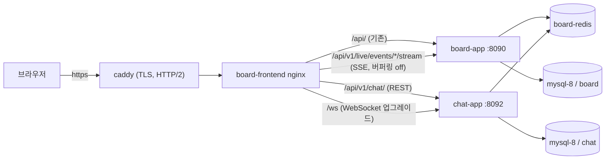

# 실시간 기능(STOMP·SSE) 배포 변경 기록

> 기준: `main` 커밋 `f21bdbc`(2026-10-10). 배포 구조(caddy → nginx → 앱, GitHub Actions → GHCR → `scripts/deploy.sh`)는
> [[DEPLOY-LIGHTSAIL]]·[[CICD-GITHUB-ACTIONS]]·[[HTTPS-DOMAIN]]이 선수 문서다.

채팅(STOMP, 별도 `chat-app` 컨테이너)과 라이브 질문·투표(SSE, `board-app` 내부)를 운영에 올리면서 **기존 배포 설정 파일에서 바꾼 것 전부**를 한곳에 모은 참조 문서다.
코드가 아니라 compose·배포 스크립트·CI·프록시 설정만 다룬다. 새로 비슷한 실시간 기능을 배포할 때 체크리스트로 쓴다.

---

## 1. 한눈에 보기

| 파일 | STOMP(chat) | SSE(라이브) | 비고 |
|------|-------------|-------------|------|
| `docker-compose.yml` | **변경** — include, chat-app override 4종 | 변경 없음 | 새 컨테이너는 chat뿐 |
| `scripts/deploy.sh` | **변경** — `JWT_SECRET`, `~/chat` 준비, chat DB 생성 | 변경 없음 | |
| `.github/workflows/deploy.yml` | **변경** — `JWT_SECRET` 전달 | 변경 없음 | |
| GitHub Secrets | **추가** — `JWT_SECRET` | 없음 | board·chat 공용 |
| `frontend/nginx.conf` | **변경** — `/api/v1/chat/`, `/ws` | **변경** — 스트림 전용 location | 두 기능 모두 여기를 거친다 |
| `frontend/vite.config.js` | **변경** — 로컬 개발 프록시 2줄 | 변경 없음 | 운영 무관(개발 서버 전용) |
| `docker-compose.override.yml` + `.gitignore` | **추가** — 로컬 전용 포트 | 없음 | git 미추적, 서버엔 없음 |
| `caddy/Caddyfile` | 변경 없음 | 변경 없음 | caddy는 WebSocket·SSE를 기본으로 통과시킨다 |



> [!IMPORTANT]
> 차이의 핵심: **chat은 새 JVM 컨테이너**라 compose·배포 스크립트·Secret·메모리 상한까지 손봐야 했고, **SSE는 기존 board-app 안의 기능**이라 nginx 한 블록만 바꾸면 됐다.

---

## 2. STOMP(chat) 변경 상세

### 2-1. `docker-compose.yml` — chat 스택을 board에 합류

| 변경 | 내용 | 왜 | 커밋 |
|------|------|----|------|
| `include` | `../chat/docker-compose.yml` + `env_file: ../chat/.env` | `docker compose up` 한 번으로 board+chat 기동 | `846cfbc` |
| `chat-app.environment.DB_NAME: chat` | 리터럴 고정 | board `.env`의 `DB_NAME=board`가 변수 치환 우선순위로 chat 쪽 `${DB_NAME:-chat}`까지 덮어 **chat이 board DB에 붙는 사고** 방지 | `846cfbc` |
| `APP_WS_ALLOWED_ORIGINS` | 운영 도메인 + `http://localhost` + `http://localhost:*` | 브라우저는 기본 포트(80/443)를 Origin에서 생략 → 포트 없는 형태를 허용해야 WS 핸드셰이크 403이 안 난다 | `f3574de` → `b9afea3` |
| `chat-app.depends_on: redis (healthy)` | | chat의 토큰 폐기 목록 조회가 fail-closed(Redis 없으면 인증 전부 500) | `b9afea3` |
| `mem_limit: 512m` + `JAVA_TOOL_OPTIONS -Xmx224m` | | **2026-09-20 사고** — 힙 상한 없는 두 번째 JVM이 2GB 무스왑 서버를 고갈시켜 SSH까지 멈춤 | `de3be5c` |

현재 설정(발췌):

```yaml
include:
  - path:
      - ../chat/docker-compose.yml
    env_file: ../chat/.env

services:
  chat-app:
    depends_on:
      redis:
        condition: service_healthy
    mem_limit: 512m
    environment:
      JAVA_TOOL_OPTIONS: "-Xmx224m -XX:MaxMetaspaceSize=128m"
      DB_NAME: chat
      APP_WS_ALLOWED_ORIGINS: https://sbs.alldayai.org,http://localhost,http://localhost:*
```

> 주의: `include`는 대상 파일이 없으면 **compose 명령 자체가 실패**한다(`docker compose ps`조차). 서버에서는 `deploy.sh`가 `~/chat`을 먼저 준비한 뒤에 compose를 부른다(2-3).

### 2-2. 로컬 전용 포트 — `docker-compose.override.yml`

처음에는 `../chat/docker-compose.local.yml`을 include했다가 `b9afea3`에서 제거하고, **git이 추적하지 않는** override 파일로 옮겼다. compose는 같은 디렉터리의 `docker-compose.override.yml`을 자동 병합한다.

```yaml
# docker-compose.override.yml (로컬에만 존재, .gitignore 대상)
services:
  chat-app:
    ports:
      - "127.0.0.1:8092:8092"
```

서버에는 이 파일이 없으므로 운영 chat-app은 호스트 포트가 닫힌 채 nginx를 통해서만 접근된다.

### 2-3. `scripts/deploy.sh` — 서버 준비 3가지 (`b9afea3`)

```bash
# ① board .env에 JWT_SECRET (board·chat이 같은 값으로 토큰 검증)
JWT_SECRET=${JWT_SECRET}

# ② compose include 대상 준비 — compose 실행 "전"에 있어야 한다
[ -d ~/chat/.git ] || git clone https://github.com/icesnake72/chat.git ~/chat
git -C ~/chat fetch --all && git -C ~/chat reset --hard origin/main
cat > ~/chat/.env <<EOF
JWT_SECRET=${JWT_SECRET}
DB_NAME=chat
DB_USERNAME=${DB_USERNAME}
DB_PASSWORD=${DB_PASSWORD}
EOF

# ③ 같은 mysql-8 인스턴스에 chat 스키마(멱등)
docker exec mysql-8 mysql -uroot -p"${DB_PASSWORD}" \
  -e "CREATE DATABASE IF NOT EXISTS chat CHARACTER SET utf8mb4 COLLATE utf8mb4_unicode_ci;"
```

### 2-4. `.github/workflows/deploy.yml` + GitHub Secret (`b9afea3`)

| 변경 | 위치 |
|------|------|
| Repository Secret `JWT_SECRET` 추가 | GitHub → Settings → Secrets and variables → Actions |
| `JWT_SECRET: ${{ secrets.JWT_SECRET }}` | deploy 스텝의 `env:` |
| `envs:` 목록에 `JWT_SECRET` 추가 | `appleboy/ssh-action`의 `with.envs` — 이게 없으면 원격 셸에 값이 안 넘어간다 |

> 팁: board의 `JWT_SECRET`은 원래 yaml 기본값을 쓰고 있었다. chat이 같은 토큰을 검증해야 하므로 Secret으로 승격했고, 이제 값을 바꿀 때는 Secret 하나만 바꾸면 양쪽이 같이 따라온다.

### 2-5. `frontend/nginx.conf` — 채팅 REST와 WebSocket (`f3574de`)

```nginx
set $chat_backend chat-app:8092;    # 같은 board-db-net의 컨테이너명(요청마다 DNS 재해석)

# 접두어 매칭은 "가장 긴 것"이 이긴다 → /api/v1/chat/ 이 /api/ 보다 우선
location /api/v1/chat/ {
  proxy_pass http://$chat_backend;
  proxy_http_version 1.1;
  proxy_set_header Host $host;
  proxy_set_header X-Real-IP $remote_addr;
  proxy_set_header X-Forwarded-For $proxy_add_x_forwarded_for;
  proxy_set_header X-Forwarded-Proto $fwd_proto;
}

# WebSocket 업그레이드 — Upgrade/Connection은 hop-by-hop 헤더라 명시적으로 넘겨야 한다
location /ws {
  proxy_pass http://$chat_backend;
  proxy_http_version 1.1;
  proxy_set_header Upgrade $http_upgrade;
  proxy_set_header Connection "upgrade";
  proxy_set_header Host $host;
  proxy_set_header X-Real-IP $remote_addr;
  proxy_set_header X-Forwarded-For $proxy_add_x_forwarded_for;
  proxy_set_header X-Forwarded-Proto $fwd_proto;
  proxy_read_timeout 3600s;
  proxy_send_timeout 3600s;
}
```

### 2-6. `frontend/vite.config.js` — 로컬 개발 서버 전용 (`f3574de`)

```js
proxy: {
  "/api/v1/chat": "http://localhost:8092",          // /api 보다 위 — 구체 경로 우선
  "/ws": { target: "ws://localhost:8092", ws: true },
  "/api": "http://localhost:8090",
},
```

운영 빌드에는 영향이 없다(운영 프록시는 nginx).

---

## 3. SSE(라이브) 변경 상세

### 3-1. `frontend/nginx.conf` — 스트림 경로만 버퍼링 끄기 (`4824a49`)

`location /api/v1/chat/` 블록 **위**에 추가:

```nginx
location ~ ^/api/v1/live/events/[^/]+/stream$ {
  proxy_pass http://$backend;
  proxy_http_version 1.1;
  proxy_set_header Connection "";
  proxy_set_header Host $host;
  proxy_set_header X-Real-IP $remote_addr;
  proxy_set_header X-Forwarded-For $proxy_add_x_forwarded_for;
  proxy_set_header X-Forwarded-Proto $fwd_proto;
  proxy_buffering off;
  proxy_cache off;
  proxy_read_timeout 3600s;
}
```

| 지시어 | 없으면 |
|--------|--------|
| `proxy_buffering off` | 이벤트가 버퍼에 갇혀 몇 개씩 뭉쳐 늦게 도착 |
| `proxy_read_timeout 3600s` | 기본 60초 무응답 시 연결 끊김(25초 heartbeat가 있어도 여유를 둔다) |
| 정규식 `~` location | 일치하면 접두어 `/api/`보다 우선 → 스트림만 정확히 골라낸다. 다른 API까지 버퍼링을 끌 이유는 없다 |

### 3-2. 설정 파일이 아닌 보조 장치(코드)

| 위치 | 내용 |
|------|------|
| `LiveEventController.stream()` | 응답 헤더 `X-Accel-Buffering: no` — nginx 설정이 빠져도 버퍼링을 끄는 이중 장치(nginx가 읽고 제거하므로 브라우저엔 안 보인다) |
| `SecurityConfig` | `GET /api/v1/live/events/*/stream` permitAll — `EventSource`가 헤더를 못 붙이므로 |

### 3-3. 바꾸지 않은 것과 이유

| 파일 | 이유 |
|------|------|
| `docker-compose.yml` | 새 컨테이너·JVM 없음(board-app 안의 기능). 2GB 서버 메모리 예산 그대로 |
| `scripts/deploy.sh`, `deploy.yml`, Secrets | 새 서버 준비물·비밀값 없음 |
| `caddy/Caddyfile` | caddy `reverse_proxy`는 `text/event-stream`을 감지해 즉시 flush한다 |
| `vite.config.js` | 기존 `/api` 프록시가 스트림까지 통과(로컬에서 실측) |

---

## 4. 배포 전 체크리스트 — 순서대로

| 순서 | 확인 | 명령 / 방법 | 해당 |
|------|------|-------------|------|
| 1 | nginx 문법 | `docker run --rm -v "$PWD/frontend/nginx.conf:/etc/nginx/conf.d/default.conf:ro" nginx:alpine nginx -t` | 둘 다 |
| 2 | compose 병합 결과 | `docker compose config chat-app \| grep -E "mem_limit\|DB_NAME\|APP_WS\|Xmx"` — `DB_NAME: chat`, `mem_limit: "536870912"`(512m), Origin 확인 | STOMP |
| 3 | GitHub Secret 존재 | `gh secret list \| grep JWT_SECRET` | STOMP |
| 4 | 테스트·기동 | `./scripts/verify.sh`, `cd frontend && npm test && npm run build` | 둘 다 |
| 5 | 로컬 도커 E2E | `docker compose build app frontend && docker compose up -d --no-deps app frontend` 후 `http://localhost`에서 실시간 확인 | 둘 다 |
| 6 | 서버 메모리 여유 | `ssh ... 'free -m; docker stats --no-stream'` — 새 JVM이면 필수 | STOMP |

---

## 5. 배포 후 확인과 장애 대응

| 확인 | 명령 | 기대 |
|------|------|------|
| SSE 경로·공개 규칙 | `curl -s https://sbs.alldayai.org/api/v1/live/events/ZZZZZZ/stream` | 404 + `LIVE_EVENT_NOT_FOUND` JSON |
| SSE 실시간 | `curl -N .../events/<코드>/stream` 후 다른 터미널에서 질문 등록 | 1초 안에 `event:question.created` |
| WebSocket 핸드셰이크 | `curl --http1.1 -i -H "Connection: Upgrade" -H "Upgrade: websocket" ...` | `--http1.1` 필수(h2에선 Upgrade 헤더가 빠져 400 오탐) |
| 컨테이너 상태 | `docker ps` | board-app, board-frontend, chat-app healthy |

| 증상 | 원인 | 조치 |
|------|------|------|
| 사이트·SSH 전면 불응 | 메모리 고갈(힙 상한 없는 JVM) | `aws lightsail reboot-instance ...` → 재부팅 후 **`docker start mysql-8`**(restart 정책 없음) |
| 앱만 재배포 후 502 | nginx가 옛 컨테이너 IP를 캐시 | `resolver 127.0.0.11` + `set $backend` 변수 방식 유지(이미 적용) |
| 채팅 연결 403 | WS Origin 미허용 | `APP_WS_ALLOWED_ORIGINS`에 도메인 추가 |
| 라이브 이벤트가 뭉쳐서 옴 | 스트림 location 누락·오타 | 3-1 블록과 `nginx -t` 확인 |
| `docker compose` 명령 자체가 실패 | `../chat` 없음 | `~/chat` clone 확인(`deploy.sh` ② 블록) |

---

## 6. 실무 기준 — 다음 실시간 기능을 배포할 때

| 질문 | 예 → 해야 할 일 |
|------|----------------|
| 새 컨테이너(JVM)를 띄우나? | compose 서비스 + **`-Xmx` + `mem_limit`** + 메모리 여유 확인 + 배포 스크립트 준비물 + Secret |
| 프로토콜 업그레이드(WebSocket)인가? | nginx에 `Upgrade`/`Connection` 전달, 긴 timeout, Origin 허용 목록 |
| 끝나지 않는 HTTP 응답(SSE·스트리밍)인가? | 해당 경로만 `proxy_buffering off` + 긴 read timeout, 앱은 `X-Accel-Buffering: no` |
| 기존 앱 안의 기능인가? | 대부분 프록시 한 블록이면 끝 — compose·CI는 그대로 |

관련: [[LIVE-POLL-WALKTHROUGH-DAY2]] Step 18(라이브 배포를 하나씩 따라 하는 절), [[CHAT-FRONTEND-WALKTHROUGH]](채팅 화면).
